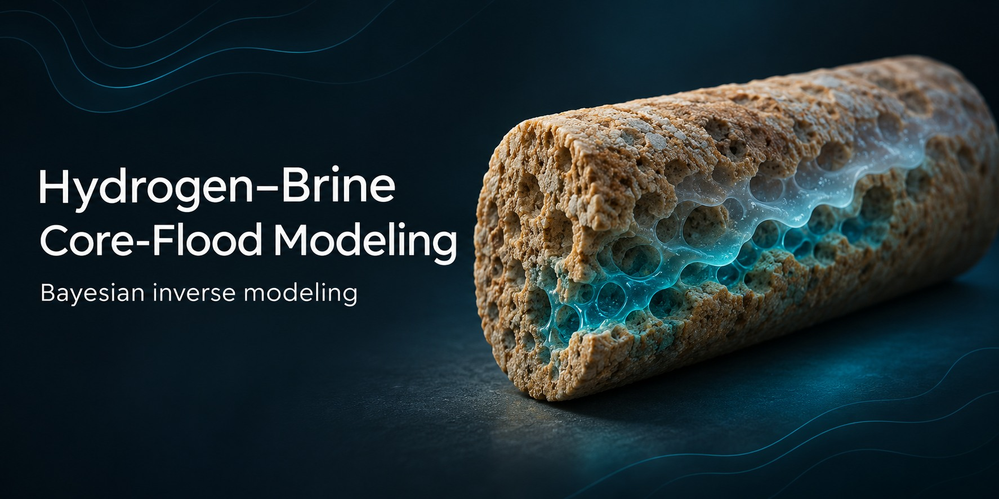
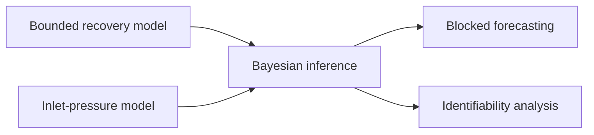
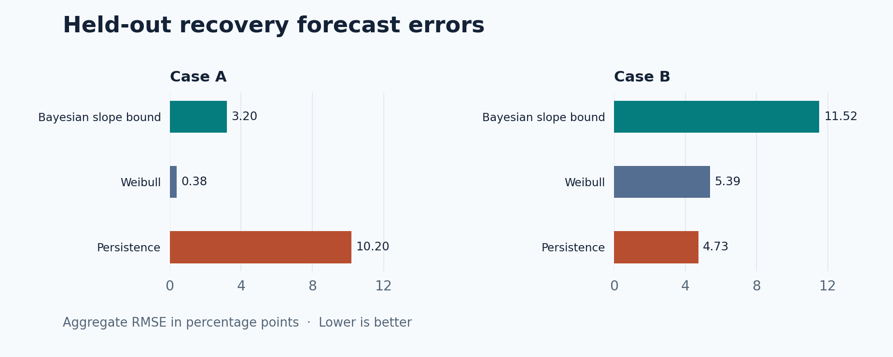
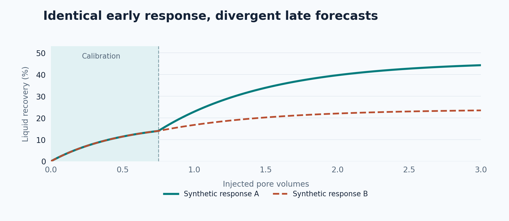

# Hydrogen–Brine Core-Flood Modeling

  

An identifiability-aware Bayesian model for forecasting liquid recovery during hydrogen displacement in porous rock. The study asks how much early recovery and inlet pressure can tell us about the later response.

[**Source code and synthetic workflow**](code/) · [Run instructions](code/README.md#run)

## Method

- **Recovery.** Nonnegative interval rates produce a monotone cumulative recovery curve. An optional unit-slope bound represents a volume-balance assumption when injected and produced volumes share a compatible reference.
- **Pressure.** A nested statistical model compares a pressure-only response with a version coupled to latent recovery. Both use the same family of startup and trend terms.
- **Inference.** Constrained Gibbs sampling estimates posterior uncertainty. Predictive intervals carry forward serially correlated errors from the end of the calibration window.
- **Evaluation.** Blocked forecasts are compared against persistence and a bounded Weibull curve. Prior sensitivity and the observation model's sensitivity to late recovery rates are examined separately.

## Selected results

  

Held-out recovery RMSE is in percentage points. Lower values indicate smaller errors within each case.

| Model | Case A | Case B |
| --- | ---: | ---: |
| Bayesian recovery, slope bound | 3.20 | 11.52 |
| Weibull least squares | **0.38** | 5.39 |
| Persistence | 10.20 | **4.73** |

The best-performing reference changed between cases. The pressure–recovery coupling intervals included zero in the main experimental fits. Adding the pressure channel supplied little direct information about the recovery response under the fitted model.

## Identifiability

When an interval starts after the calibration window, its recovery basis term is zero throughout that window. Early observations therefore provide no direct likelihood information about that interval's rate. The illustrative example below shows how two admissible curves can agree throughout calibration and diverge afterward.

  

The results support a laboratory-scale interpretation. Independent experiments are needed to assess transfer to other cores or reservoir conditions.

## Data availability

The laboratory measurements are confidential. This page shares only aggregate results, a synthetic illustration and a conceptual cover image.
